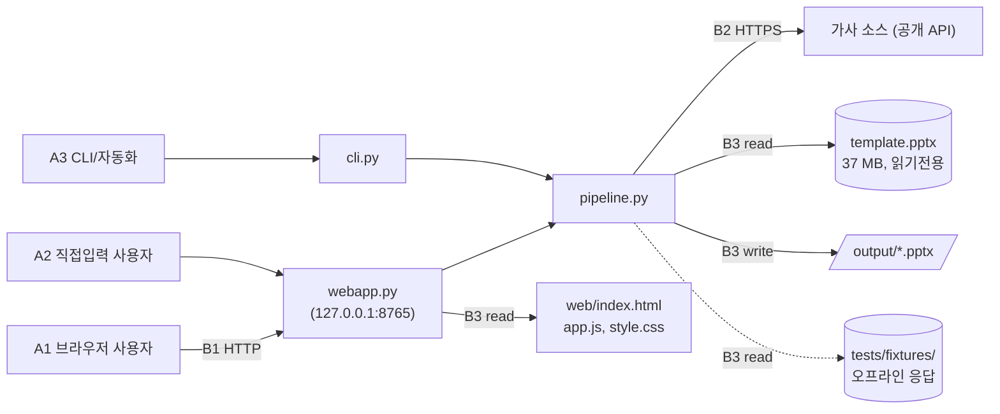
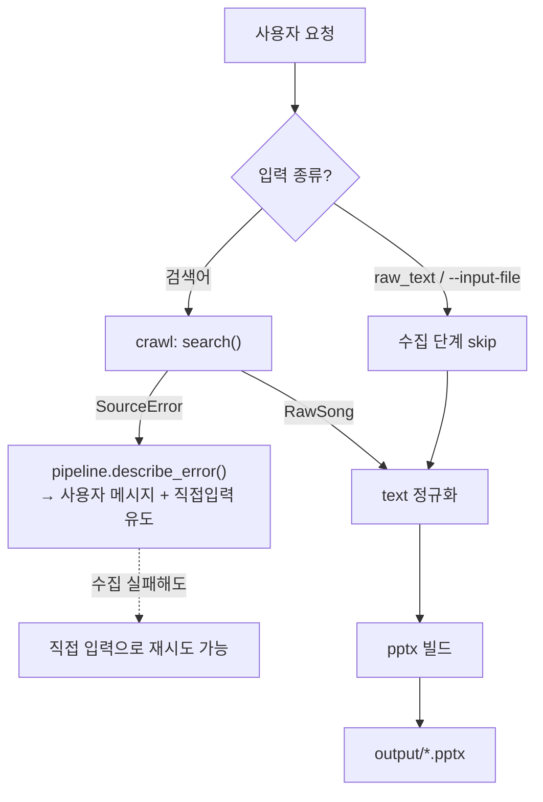

# 01. 시스템 컨텍스트 (System Context)

상위: `아키텍처.md` §1–2 / 요구 원문: `계획서.md`, `docs/plan/01-goals-and-scope.md` (복제하지 않고 참조).

## 1. 시스템 경계

`lyrics-2line-pptx` 는 **사용자 PC 에서 실행되는 단일 프로세스 도구**다. 시스템은 세 종류의 외부와만 접촉한다.

| 경계 | 방향 | 대상 | 프로토콜 |
| --- | --- | --- | --- |
| B1 사용자 | in | 로컬 브라우저 / 명령 프롬프트 | HTTP(127.0.0.1) / argv |
| B2 가사 소스 | out | 공개 JSON API(기본) 또는 사용자가 활성화한 사이트 | HTTPS GET |
| B3 파일 시스템 | in/out | `template.pptx`(읽기), `output/*.pptx`(쓰기), `web/`(읽기), `tests/fixtures/`(읽기) | 파일 I/O |

경계 밖에 **우리가 통제하지 않는** 것: PPTX 렌더러(PowerPoint 등), 가사 소스의 가용성/약관, 사용자 OS 환경.
이 세 가지를 아키텍처가 보상한다.

| 통제 불가 요소 | 아키텍처 보상 |
| --- | --- |
| 렌더러가 텍스트 넘침을 판단 | `normAutofit` 로 위임 (AD-07) |
| 소스가 차단/구조 변경 | 어댑터 격리 + 직접 입력 경로 1급화 (AD-05) |
| 사용자 OS 의 파일 잠금 | 시작 시 검사 후 명시적 종료, 원자적 쓰기 (AD-13) |

## 2. 액터와 사용 시나리오

| 액터 | 목표 | 진입점 | 성공 신호 |
| --- | --- | --- | --- |
| A1 최종 사용자 | 검색어로 가사를 pptx 로 받는다 | `webapp.py` | 브라우저 다운로드 완료 |
| A2 최종 사용자(오프라인) | 이미 가진 텍스트로 pptx 를 만든다 | `webapp.py` 직접입력 / `cli.py --input-file` | 파일 생성 |
| A3 개발자/자동화 | 재현 가능한 배치 변환 | `cli.py` | 종료코드 0 |
| A4 개발자 | 회귀 검증 | `unittest` | 전 테스트 통과, 네트워크 0회 |

액터-시스템 다이어그램:



## 3. 런타임 토폴로지

| 프로세스 | 수명 | 스레드 | 비고 |
| --- | --- | --- | --- |
| CLI 프로세스 | 단발 종료 | 1 | `argparse` → `pipeline.run()` → 종료 |
| 웹서버 프로세스 | Ctrl+C 까지 | `ThreadingHTTPServer` (요청별 스레드) | 요청 동시성은 있어도 **빌드 동시성은 0** (AD-14) |
| 테스트 러너 | 단발 | 1 | 네트워크 소켓 차단 또는 fixture 모드 |

**동시성 모델 결정**: 웹서버는 스레드 기반이지만 pptx 빌드는 프로세스 전역 `threading.Lock` 으로 **직렬화**한다.
이유: 빌드 1건이 37MB 템플릿을 열어 메모리에 올리므로, 병렬 빌드는 메모리와 파일 잠금 위험만 늘린다.
검색(API) 호출은 락 밖에서 실행해도 되지만, 요청 수가 적으므로 단순성을 위해 요청 처리 전체를 락으로 감싼다.

```python
# webapp.py (요지)
_build_lock = threading.Lock()
def handle_generate(...):
    with _build_lock:            # 동시 빌드 0 (AD-14)
        path = pipeline.run(...)
```

## 4. 외부 의존과 실패 격리

| 외부 의존 | 없을 때 | 격리 지점 |
| --- | --- | --- |
| 가사 소스(네트워크) | 직접 입력 경로로 기능 유지 | `pipeline.run(raw_text=...)` 는 네트워크를 호출하지 않는다 |
| `python-pptx` | 도구 전체 불가 | `__init__.py` import 실패 시 설치 안내 메시지로 종료 |
| `template.pptx` | pptx 생성 불가 | 시작 시 존재/열기 검사 → `TemplateStructureError` |
| PowerPoint 렌더러 | 산출물 검증만 불가 | 테스트는 `Presentation()` 재열기로 무결성 확인 |

핵심 격리 원칙: **수집 실패가 pptx 기능을 막지 않는다.** 수집(`crawl`)은 교체 가능한 어댑터 뒤에 있고,
직접 입력 경로는 수집 계층을 완전히 우회한다. (계획서 01 R3/R4 대응)



## 5. 외부 파일 계약 (읽기 전용 vs 산출물)

| 파일/디렉터리 | 권한 | 규칙 (강제) |
| --- | --- | --- |
| `template.pptx` | **읽기 전용** | 쓰기 모드로 열지 않는다. 테스트가 빌드 전후 해시 동일을 단언한다 |
| `web/index.html`, `app.js`, `style.css` | 읽기 전용 | 서버가 `web/` 밖 파일을 제공하지 않는다 (경로 탈출 차단) |
| `tests/fixtures/*` | 읽기 전용 | fixture 모드에서만 접근 |
| `output/` | 쓰기 | 없으면 생성. 산출물만 저장. tmp 는 이 디렉터리 안에 만든다 |
| `output/.tmp-*.pptx` | 임시 | `os.replace` 성공 시 사라짐. 실패 시 정리 (AD-13) |

## 6. 경계 횡단 규칙 (요약)

1. `webapp.py`/`cli.py` 는 **`pipeline.run()` 과 `pipeline.describe_error()` 외의 도메인 함수를 호출하지 않는다.**
2. `pipeline.py` 만이 3개 축(`crawl`/`text`/`pptx`)을 import 한다.
3. 각 축 내부는 자기 축만 import 한다. 축 간 데이터 전달은 `errors.py` 와 dataclass 로만.
4. 네트워크는 `crawl/httputil.py` 를 통해서만 발생한다 (직접 `urllib` 호출 금지 — robots/지연 우회 방지).

상세 의존 방향과 순환 금지 규칙: `docs/arch/02-component-architecture.md`.
경계별 데이터 타입: `docs/arch/03-data-architecture.md`.
