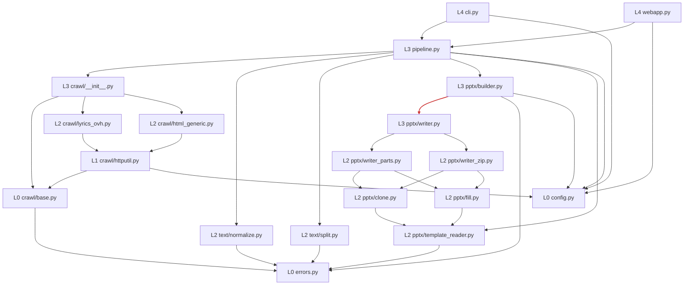
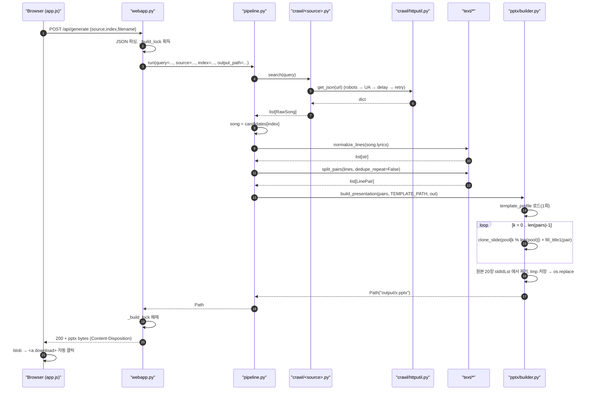
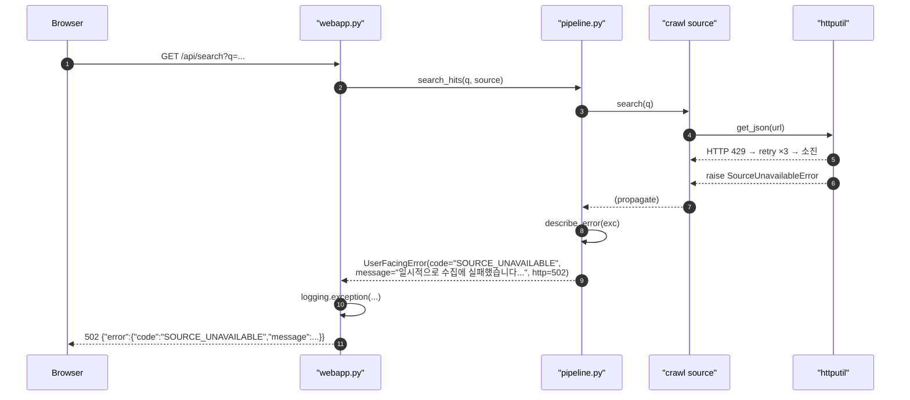

# 02. 컴포넌트 아키텍처 (Component Architecture)

상위: `아키텍처.md` §2 / 계획서 02 §모듈 책임 (참조). 이 문서는 **경계와 의존 방향을 강제 가능한 규칙으로** 확정한다.

## 1. 계층(Layer) 정의

```
L0  leaf       : errors.py, config.py, crawl/base.py
L1  infrastructure : crawl/httputil.py
L2  domain     : text/normalize.py, text/split.py,
                 pptx/template_reader.py, pptx/clone.py, pptx/fill.py,
                 pptx/writer_parts.py, pptx/writer_zip.py,
                 crawl/lyrics_ovh.py, crawl/html_generic.py
L3  composition: crawl/__init__.py, pptx/builder.py, pptx/writer.py, pipeline.py
L4  entrypoint : cli.py, webapp.py
```

**허용 의존 방향: L(n) → L(0..n-1).** 같은 계층 내에서도 아래 §3 의 명시 허용 목록에 있는 화살표만 허용한다.
L4 는 아무도 import 하지 않는다. L4 → L4 금지 (`cli` ↔ `webapp` 상호 의존 금지).

## 2. 모듈 책임 (경계 포함)

| 모듈 | 계층 | 하는 일 | **하지 않는 일** |
| --- | --- | --- | --- |
| `errors.py` | L0 | 예외 트리의 루트 `Lyrics2PptxError` 와 횡단 예외 정의 | 네트워크, 파일, XML 접근 |
| `config.py` | L0 | 상수, 경로 해석, `os.environ` 읽기, 기본값 | 도메인 로직. **env 접근은 이 모듈에만 존재** |
| `crawl/base.py` | L0 | `RawSong`, `Source` 프로토콜, `SourceError` 계층 | 네트워크 접근 |
| `crawl/httputil.py` | L1 | robots 확인, UA, 지연, 재시도/백오프, fixture 훅 | 사이트별 파싱, 텍스트 정규화 |
| `crawl/<site>.py` | L2 | 특정 소스 → `RawSong` 매핑 | 규칙 우회(직접 `urllib` 호출 금지), 파일 저장, 정규화 |
| `crawl/__init__.py` | L3 | `SOURCES` 레지스트리, `get_source(name)` | 파싱 로직 |
| `text/normalize.py` | L2 | `str` → `list[str]` (N1~N10) | 슬라이드 페어링, pptx 접근 |
| `text/split.py` | L2 | `list[str]` → `list[LinePair]` | pptx 접근, 파일 I/O |
| `pptx/template_reader.py` | L2 | 템플릿 1회 분석(template profile), 배경 풀, 슬라이드별 스타일 캐시 | 슬라이드 생성/저장 |
| `pptx/clone.py` | L2 | 슬라이드 1장 복제 + rels 재매핑 | 텍스트 내용 결정, 배경 선택 |
| `pptx/fill.py` | L2 | `제목 1` txBody 재구성 + `normAutofit` | 복제, 배경, 저장 |
| `pptx/writer_parts.py` | L2 | 방식 A: `<p:sld>` deepcopy → 새 파트 등록 후 python-pptx 로 저장 | 템플릿 분석, 배경 선택 |
| `pptx/writer_zip.py` | L2 | 폴백 F1: OPC zip 재작성 | 템플릿 분석, 배경 선택 |
| `pptx/writer.py` | L3 | 작성기 전략 선택(`select_writer`)과 능력 프로브 | 슬라이드 파싱/채우기/저장 로직 자체 |
| `pptx/builder.py` | L3 | 배경 순환 + 복제/채우기 조립 + 원자적 저장 | 수집, 정규화, 배경 선택 규칙 변경 |
| `pipeline.py` | L3 | 3축 조립, `describe_error()`(오류→사용자 메시지 단일 지점) | 각 단계 내부 로직 |
| `cli.py` | L4 | argv 파싱, 로깅 초기화, 종료코드 | 도메인 로직 |
| `webapp.py` | L4 | HTTP 라우팅, 바인딩, 직렬화, 락 | 도메인 로직, 파일 저장(빌더에 위임) |

## 3. 허용 화살표 (완전 목록 — 이 외의 import 는 금지)

```
lyrics2pptx/__init__.py       → errors.py, pipeline.py   (지연 재수출: PEP 562 __getattr__)
cli.py                        → pipeline.py, config.py, errors.py
webapp.py                     → pipeline.py, config.py, errors.py
pipeline.py                   → crawl/__init__.py, text/normalize.py, text/split.py,
                                pptx/__init__.py, pptx/builder.py, pptx/template_reader.py,
                                config.py, errors.py
crawl/__init__.py             → crawl/base.py, crawl/lyrics_ovh.py, errors.py
crawl/lyrics_ovh.py           → crawl/base.py, crawl/httputil.py, config.py
crawl/html_generic.py         → crawl/base.py, crawl/httputil.py
crawl/httputil.py             → crawl/base.py, errors.py, config.py
crawl/base.py                 → errors.py
text/__init__.py              → text/normalize.py, text/split.py
pptx/__init__.py              → pptx/builder.py, pptx/clone.py, pptx/fill.py,
                                pptx/template_reader.py, pptx/writer.py,
                                pptx/writer_parts.py, pptx/writer_zip.py
pptx/builder.py               → pptx/template_reader.py, pptx/writer.py, config.py, errors.py
pptx/writer.py                → pptx/clone.py, pptx/template_reader.py,
                                pptx/writer_parts.py, pptx/writer_zip.py, config.py, errors.py
pptx/writer_parts.py          → pptx/clone.py, pptx/fill.py, pptx/template_reader.py,
                                config.py, errors.py
pptx/writer_zip.py            → pptx/clone.py, pptx/fill.py, pptx/template_reader.py,
                                config.py, errors.py
pptx/clone.py                 → pptx/template_reader.py, errors.py, config.py
pptx/fill.py                  → pptx/template_reader.py, errors.py, config.py
pptx/template_reader.py       → config.py, errors.py
text/normalize.py             → (내부 import 없음)
text/split.py                 → (내부 import 없음)
errors.py                     → (표준 라이브러리만)
config.py                     → errors.py
```

**writer 사슬의 P5/P8 근거 (실제 import 그래프 확인).** `builder → writer → {writer_parts, writer_zip} → {clone, fill, template_reader}` 사슬은
`src/lyrics2pptx` 를 `ast` 로 파싱한 실제 import 그래프에서 확인한 엣지이며, 위 목록에 그대로 반영했다.

* `pptx/builder.py → pptx/clone.py, pptx/fill.py` 직접 엣지는 **코드에 없다** — 빌더는 `writer`
  (`writer_parts`/`writer_zip`)를 거쳐 `clone`/`fill` 에 도달하므로 그 두 화살표를 목록에서 제거했다.
* **P5(하위 → `builder` 금지)**: `writer_parts`/`writer_zip` 은 `clone`/`fill`/`template_reader`/`config`/`errors` 만,
  `clone`/`fill`/`template_reader` 는 `template_reader`/`config`/`errors` 만 import 한다. `builder` 로 향하는 역방향 엣지는 없다.
* **P8(순환 금지)**: 위 화살표는 단방향 DAG 이고 `pptx/__init__.py` 는 재수출(집계)만 하므로 어떤 사이클도 생기지 않는다.
* 검증: `test_imports.py` 의 `test_p5_low_level_pptx_never_imports_builder` 와 `test_p8_import_graph_has_no_cycles` 가
  실제 AST 그래프에서 위반 0 을 단언하고, `test_documented_writer_chain_exists` 가 이 사슬의 존재를 고정한다.
* **정정 근거(Documenter — 코드 기준 재검증).** 위 목록은 `src/lyrics2pptx` 를 `ast` 로 파싱한 실제 import
  그래프(`test_imports.ImportGraph`)로 다시 대조해 다음 드리프트를 고쳤다.
  - **과다 선언 제거**: `crawl/lyrics_ovh.py → errors.py`(코드에 없음), `crawl/html_generic.py → errors.py/config.py`
    (실제로는 `crawl/base.py`·`crawl/httputil.py` 만), `text/normalize.py`·`text/split.py → errors.py/config.py`
    (두 모듈 모두 **내부 import 0**), `crawl/__init__.py → crawl/html_generic.py`(비활성 스켈레톤이라 import 안 함).
  - **누락 추가**: 루트 `lyrics2pptx/__init__.py → errors.py, pipeline.py`(지연 재수출),
    `text/__init__.py → text/normalize.py, text/split.py`, `crawl/__init__.py → errors.py`, `config.py → errors.py`.
  - `cli.py`/`webapp.py` 의 `from . import __version__` 은 모듈 엣지가 아니라 이름 import 이므로 목록에 넣지 않는다.
* 상호참조: 폴백 F1 의 대상 모듈은 `04 §6`, 태스크별 생성 파일은 `10 §1`(T04/T06)·`10 §3` 이
  `writer.py`/`writer_parts.py`/`writer_zip.py` 를 이미 요구하므로, 위 목록이 그 문서들과 일치한다.

## 4. 금지 규칙 (테스트로 강제)

| # | 금지 | 이유 | 검증 |
| --- | --- | --- | --- |
| P1 | `text/* → pptx/*` | 텍스트 축은 문서 형식을 모른다 (교체 가능성 유지) | `test_imports.py` |
| P2 | `text/* → crawl/*` | 문자열 처리는 수집 출처와 무관하다 | `test_imports.py` |
| P3 | `pptx/* → crawl/*` | 문서 생성은 가사 출처를 모른다 | `test_imports.py` |
| P4 | `crawl/* → text/*`, `crawl/* → pptx/*` | 수집 축은 소비자를 모른다 | `test_imports.py` |
| P5 | `clone|fill|template_reader → builder` | 조립은 단방향이다 (하위가 상위를 부르면 순환) | `test_imports.py` |
| P6 | 임의 모듈 → `cli`/`webapp` | 진입점은 leaf 다 | `test_imports.py` |
| P7 | 어댑터가 `urllib` 직접 사용 | robots/지연/UA 우회 차단 | 코드리뷰 + `test_httputil.py` |
| P8 | 순환 의존(어떤 형태든) | 조립/초기화 순서 붕괴 | `test_imports.py` (DFS 사이클 검출) |
| P9 | `config`/`errors` 외 모듈의 `os.environ` 접근 | 설정 출처 단일화 | `test_imports.py` (grep 기반) |

`test_imports.py` 구현 방식: `src/lyrics2pptx` 를 `ast` 로 파싱해 import 그래프를 만들고,
`$PYTHONPATH=src python -m tests.test_imports` 로 위 9개 규칙을 단언한다. (T01 에 포함)

## 5. 컴포넌트 다이어그램 (레이어 + 허용 화살표)



(정정: 이전 판은 `BUILD → CLONE`/`BUILD → FILL` 화살표가 있었으나 **그 직접 엣지는 코드에 없다** —
빌더는 `writer` 를 거쳐 도달한다. 새 그림은 `builder → writer → {writer_parts, writer_zip} → {clone, fill}`
사슬을 그대로 반영한다. `linkStyle 13` 은 새 `BUILD → WRITER` 화살표를 강조하는 시각 표시일 뿐이며
의미는 없다. 노드를 추가하면 링크 인덱스가 밀리므로 인덱스는 실제 edge 순서로 다시 세어 맞췄다.)

## 6. 시퀀스 다이어그램 — 정상 경로 (검색 기반 생성)



## 7. 시퀀스 다이어그램 — 오류 경로 (오류→메시지 단일 지점)



핵심: **오류 타입 → 사용자 문구/HTTP 상태 변환은 `pipeline.describe_error()` 한 함수에만 존재한다.**
`webapp.py` 는 `UserFacingError.http_status` 를 그대로 쓰고, `cli.py` 는 `message` 만 출력한다. (AD-09)

## 8. 확장 지점 (교체만으로 확장, 수정 없이)

| 확장하고 싶은 것 | 손대는 곳 | 손대지 않는 곳 |
| --- | --- | --- |
| 다른 가사 소스 | `crawl/<new>.py` 추가 + `SOURCES` 한 줄 | `text/`, `pptx/`, `pipeline.py` |
| 다른 템플릿 | `config.TEMPLATE_PATH` / `LYRICS2PPTX_TEMPLATE` | 모든 코드 |
| 배경 순환 규칙 변경 | `pptx/builder.py` 의 `pool` 구성 1곳 | `clone.py`, `fill.py` |
| 다른 출력 형식 | `pptx/builder.py` 뒤에 새 builder 모듈 | `crawl/`, `text/` |
| 다른 전달 채널 | 새 L4 진입점 추가 | `pipeline.py` 이하 전부 |

이 표가 계층 분리의 목적이다: **확장은 추가(add)이지, 기존 축의 수정(modify)이 아니다.**
