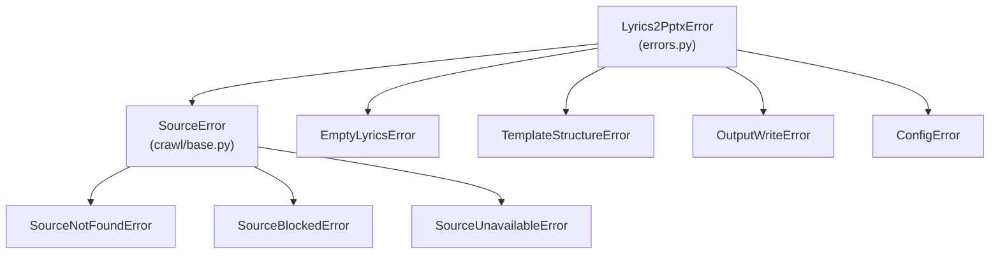

# 03. 데이터 아키텍처 (Data Architecture)

상위: `아키텍처.md` §4 / 계획서 02 §데이터 계약, 03 §인터페이스, 04 §2 (참조).
이 문서는 **경계마다 오가는 정확한 타입**과 **예외 트리**를 확정한다. 필드명·타입은 Coder 가 그대로 옮긴다.

## 1. 파이프라인 데이터 흐름 (경계별 타입)

```
query: str
  └─(B2 네트워크)─ Source.search(query, limit) ─→ candidates: Sequence[RawSong]
       └─ 후보 선택(index) ─→ song: RawSong
            └─ normalize_lines(song.lyrics: str) ─→ lines: list[str]
                 └─ split_pairs(lines, dedupe_repeat) ─→ pairs: list[LinePair]
                      └─ build_presentation(pairs, template, out) ─→ result: BuildResult
                           └─ result.output_path: Path ─→ (B1) HTTP body / CLI stdout
```

각 화살표의 계약:

| 경계 | 입력 타입 | 출력 타입 | 실패 시 예외 | 소유 모듈 |
| --- | --- | --- | --- | --- |
| E1 search | `query: str`, `limit: int=5` | `Sequence[RawSong]` | `SourceNotFoundError` | `crawl/<site>.py` |
| E2 select | `Sequence[RawSong]`, `index: int` | `RawSong` | `SourceNotFoundError`(범위 밖) | `pipeline.py` |
| E3 normalize | `lyrics: str` | `list[str]` | (없음 — 빈 리스트 반환) | `text/normalize.py` |
| E4 split | `list[str]`, `dedupe_repeat: bool` | `list[LinePair]` | (없음 — 빈 리스트 반환) | `text/split.py` |
| E5 build | `list[LinePair]`, `Path`, `Path\|None` | `BuildResult` | `EmptyLyricsError`, `TemplateStructureError`, `OutputWriteError` | `pptx/builder.py` |
| E6 render | `BuildResult` | JSON / pptx bytes | `OutputWriteError` | `webapp.py` / `cli.py` |

**규칙 E3/E4**: 정규화/분할은 **예외를 던지지 않고 빈 결과를 반환**한다. "유효 줄 0개" 판정은
빌드 진입점(`pipeline.run`)이 단 한 번만 한다 → 오류 판정 지점이 하나로 유지된다 (AD-09).

## 2. dataclass 계약 (전체)

```python
# ---- L0: errors.py ---------------------------------------------------------
class Lyrics2PptxError(Exception):
    """이 프로젝트의 모든 도메인 예외 루트."""

class EmptyLyricsError(Lyrics2PptxError):
    """정규화/분할 후 유효 줄이 0개."""

class TemplateStructureError(Lyrics2PptxError):
    """템플릿 구조가 기대와 다름 (도형 없음, 파트 등록 불가 등)."""

class OutputWriteError(Lyrics2PptxError):
    """output 경로 생성/원자적 교체 실패."""

class ConfigError(Lyrics2PptxError):
    """설정값/경로가 유효하지 않음."""

# ---- L0: crawl/base.py -----------------------------------------------------
@dataclass(frozen=True, slots=True)
class RawSong:
    title: str
    artist: str | None
    lyrics: str                 # 원문 그대로 (정규화 전), 비어 있을 수 있음
    source_name: str            # 예: "lyrics_ovh"
    source_url: str | None = None

class SourceError(Lyrics2PptxError):
    """모든 수집 예외의 상위 (collector 하위 트리)."""

class SourceNotFoundError(SourceError): ...       # 검색 결과 0건, 필드 없음
class SourceBlockedError(SourceError): ...        # robots Disallow, 403/404
class SourceUnavailableError(SourceError): ...    # 재시도 소진, 파싱 실패

class Source(Protocol):
    name: str
    def search(self, query: str, *, limit: int = 5) -> Sequence[RawSong]: ...
```

```python
# ---- L2: text/split.py -----------------------------------------------------
LinePair = tuple[str, str | None]        # (첫째 줄, 둘째 줄) — 홀수 마지막은 둘째 None

# ---- L2: pptx/template_reader.py -------------------------------------------
@dataclass(frozen=True, slots=True)
class StyleSpec:
    """한 템플릿 슬라이드의 '제목 1' 서식 스냅샷."""
    slide_index: int            # 0-based template 인덱스
    rpr_xml: bytes              # <a:rPr> 직렬화 (deepcopy 원본). 없으면 None-대체 플래그
    has_rpr: bool
    bodypr_xml: bytes           # <a:bodyPr> 직렬화
    sz: int | None              # 원본 run 크기 (1/100 pt). 예: 6000
    shape_found: bool           # '제목 1' 도형 존재 여부
    paragraph_count: int        # 원본 문단 수 (진단용)

@dataclass(frozen=True, slots=True)
class TemplateProfile:
    template_path: Path
    template_size: int          # bytes — 캐시 무효화 키
    template_mtime_ns: int      # 캐시 무효화 키
    slide_count: int            # 20
    pool: tuple[int, ...]       # 배경 풀 (구성된 순서). 예: (0,1,...,19)
    styles: Mapping[int, StyleSpec]
    default_style: StyleSpec    # '제목 1' rPr 을 가진 첫 슬라이드의 스타일 (폴백 소스)
    slide_size: tuple[int, int] # EMU (12192000, 6858000)

# ---- L3: pptx/builder.py ---------------------------------------------------
@dataclass(frozen=True, slots=True)
class SlideSpec:
    """출력 슬라이드 1장의 조립 명세 (빌더 내부 타입)."""
    order: int                  # 0-based 출력 순서 k
    bg_index: int               # template 슬라이드 인덱스 = pool[k % len(pool)]
    line1: str
    line2: str | None
    style: StyleSpec            # bg_index 의 스타일

@dataclass(frozen=True, slots=True)
class BuildResult:
    output_path: Path
    slide_count: int            # = len(pairs)
    pool_size: int              # = len(pool)
    wrap_count: int             # 배경이 한 바퀴 이상 돈 횟수 = (slide_count-1)//pool_size
    used_bg_indices: tuple[int, ...]   # 실제 사용된 배경 인덱스 순서 (검증용)
    dropped_notes_count: int    # 노트 미복제로 버려진 notesSlide 수 (= slide_count)

# ---- L4: pipeline.py -------------------------------------------------------
@dataclass(frozen=True, slots=True)
class UserFacingError:
    code: str                   # "SOURCE_UNAVAILABLE" 등 (계획서 06 §오류 표)
    message: str                # 사용자에게 보이는 한국어 문구
    http_status: int            # 웹앱이 그대로 사용
    recoverable: bool           # True 면 "직접 입력 유도" 노출

@dataclass(frozen=True, slots=True)
class SearchHit:
    index: int                  # 후보 목록 내 위치 (== RawSong 리스트 인덱스)
    title: str
    artist: str | None
    source_name: str
    preview_lines: tuple[str, ...]   # 정규화 후 앞 3줄

# ---- L2/L4: crawl/crosscheck.py · pipeline.py (ADR-018) --------------------
@dataclass(frozen=True, slots=True)
class Transcript:               # crawl/crosscheck.py — 페이지 1장의 전사본
    source: str                 # 호스트 등 짧은 라벨
    lines: tuple[str, ...]
    url: str | None = None

@dataclass(frozen=True, slots=True)
class Consensus:                # 줄별 다수결 결과
    entries: tuple[LineConsensus, ...]
    source_count: int           # 투표에 참여한(중복 제거 후) 전사본 수
    # .lines = tuple(entry.text …), .disagreements = 합의가 갈린 항목만

@dataclass(frozen=True, slots=True)
class CrossCheckLine:           # pipeline.py — 사용자에게 보여줄 근거 1줄
    text: str                   # 합의(다수결) 표기
    support: int                # 이 표기를 쓴 페이지 수
    total: int                  # 전체 페이지 수
    variants: tuple[str, ...]   # 다른 표기(오타/띄어쓰기) — 조용히 버리지 않는다
```

### dataclass 설계 규칙

| 규칙 | 값 | 이유 |
| --- | --- | --- |
| 불변성 | 전부 `frozen=True, slots=True` | 경계를 넘는 값이 중간에 바뀌지 않게 (테스트 결정성) |
| 위치 인자 | 경계 타입(`RawSong`, `LinePair`)은 위치 허용 | 테스트 가독성 |
| 컬렉션 필드 | `tuple` 사용(리스트 금지) | frozen + 해시 가능 |
| `LinePair` | `tuple[str, str|None]` 별칭 고정 | 계획서 04 의 반환 계약과 동일 |
| 스타일 전달 | XML 을 **직렬화한 bytes** 로 보관 | lxml 요소를 여러 슬라이드가 공유하면 deepcopy 시 부작용 |

## 3. 예외 트리 (단일 루트)



| 예외 | 발생 지점 (단일) | HTTP | 사용자 메시지 (계획서 03/06 표 그대로) |
| --- | --- | --- | --- |
| `SourceNotFoundError` | `crawl/<site>.py` (결과 0건/필드 없음) | 404 | "검색 결과가 없습니다. 다른 검색어를 시도하거나 가사를 직접 붙여넣으세요." |
| `SourceBlockedError` | `crawl/httputil.py` (robots/403/404) | 423 | "이 소스는 자동 수집이 차단되었습니다. 직접 입력을 사용하세요." |
| `SourceUnavailableError` | `crawl/httputil.py` (재시도 소진/파싱 실패) | 502 | "일시적으로 수집에 실패했습니다. 잠시 후 재시도하세요." |
| `EmptyLyricsError` | `pipeline.run()` (pairs 가 빈 경우) | 422 | "가사에서 유효한 줄을 찾지 못했습니다." |
| `TemplateStructureError` | `pptx/template_reader.py`, `pptx/fill.py`, `pptx/clone.py` | 500 | "템플릿 구조를 읽을 수 없습니다: <원인>" |
| `OutputWriteError` | `pptx/builder.py` (tmp/replace 실패) | 500 | "파일을 저장하지 못했습니다: <경로>" |
| `ConfigError` | `config.py`, `cli.py` (인자 검증) | 400 | "설정이 올바르지 않습니다: <키>" |

**불변 규칙**: 위 표에 없는 예외를 새로 만들지 않는다. 예상치 못한 예외(`OSError` 등)는
`webapp.py` 에서 `except Exception` → 500 `INTERNAL` 로 변환하되 스택은 서버 로그에만 남긴다.

## 4. 오류 → 사용자 메시지 변환 지점 (단일)

```python
# pipeline.py — 이 함수가 유일한 변환 지점 (AD-09)
_MESSAGE_TABLE: dict[type[Lyrics2PptxError], tuple[str, int, bool]] = {
    SourceNotFoundError:    ("SOURCE_NOT_FOUND",    404, True),
    SourceBlockedError:     ("SOURCE_BLOCKED",      423, True),
    SourceUnavailableError: ("SOURCE_UNAVAILABLE",  502, True),
    EmptyLyricsError:       ("EMPTY_LYRICS",        422, False),
    TemplateStructureError: ("TEMPLATE_ERROR",      500, False),
    OutputWriteError:       ("OUTPUT_WRITE_ERROR",  500, False),
    ConfigError:            ("BAD_REQUEST",         400, False),
}

def describe_error(exc: BaseException) -> UserFacingError:
    """계획서 03 §실패 케이스 / 06 §오류 응답 규약의 유일한 구현."""
```

`webapp.py` 는 `user_facing.http_status`/`.code`/`.message` 를 그대로 응답에 쓰고,
`cli.py` 는 `user_facing.message` 를 stderr 에 출력하고 `recoverable` 이면 직접 입력 안내를 덧붙인다.

## 5. 저장소 구조 (파일이 곧 DB)

| 데이터 | 저장 위치 | 수명 | 스키마 변경 시 |
| --- | --- | --- | --- |
| 산출 pptx | `output/<filename>.pptx` | 사용자 삭제 전까지 | 해당 없음 (파일 포맷은 OOXML) |
| 검색 캐시 | 프로세스 메모리 `dict[(source, 검색어), tuple[RawSong, ...]]` — **limit 은 키가 아니다**(ADR-020: 클릭한 `index` 와 빌드가 같은 목록을 보게) | 프로세스 종료 시 소멸 | 재시작으로 초기화 |
| 템플릿 프로필 | 프로세스 메모리, `(path, size, mtime_ns)` 키 | 파일 변경 시 무효화 | 자동 재분석 |
| fixture | `tests/fixtures/*.json|.txt` | 리포지토리 자산 | 테스트가 회귀 보호 |

**마이그레이션 전략**: 없음(스키마리스). 산출 pptx 는 OOXML 표준이므로 별도 버전 관리 대상이 아니다.
대신 **호환성 계약**을 둔다: 산출 pptx 는 `pptx.Presentation()` 으로 다시 열려야 하고(테스트),
PowerPoint 에서 손상 경고가 없어야 한다(T12 수동 체크).

## 6. 크기/수명 추정 (아키텍처 제약 확정)

| 항목 | 값 | 아키텍처 결정에 미치는 영향 |
| --- | --- | --- |
| 템플릿 | 37,248,076 bytes | 빌드 1회당 메모리 상주. 빌드 동시성 0 (AD-14), 프로필 캐시 |
| media 파트 | 20개 (jpeg/png 혼재) | 복제 시 **파트 재사용** 필수 — 새로 등록하면 N배 팽창 (AD-06) |
| slideLayout | 54개 | 복제 시 layout rel 을 원본과 동일하게 연결 (AD-04) |
| notesSlide | 20개 | 복제하지 않음 (AD-08) |
| 산출 슬라이드 | `ceil(줄수/2)` 장 | 배경 순환 공식의 입력 (AD-10) |
| 산출 파일 | ≈ 템플릿 크기 (복제 수에 따라 ±) | output 디스크 사용량 주의 (08 §6) |

## 7. 경계 계약 검증 (테스트가 지키는 것)

| 계약 | 테스트 | 단언 |
| --- | --- | --- |
| `LinePair` 타입 | `test_split.py` | 반환이 정확히 `list[tuple[str, str|None]]` |
| `RawSong` 불변 | `test_split.py` | frozen 재할당 시 `FrozenInstanceError` |
| E3/E4 무예외 | `test_normalize.py`, `test_split.py` | 빈 입력 → `[]` 반환(예외 아님) |
| 오류 매핑 단일성 | `test_pipeline_errors.py` | `describe_error` 가 표의 7종 모두 커버 |
| 재열기 무결성 | `test_builder.py` | `Presentation(result.output_path)` 성공 |
