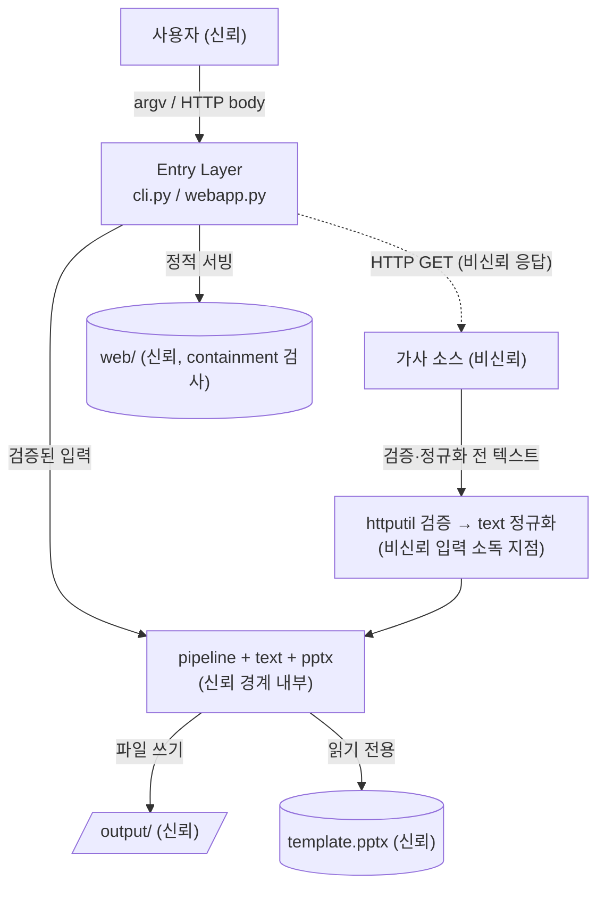

# 06. 보안·법적 경계 아키텍처 (Security & Legal Boundary)

상위: `아키텍처.md` §4 / 계획서 03 §법적/윤리 체크리스트 (참조). 이 문서는 "무엇을 어느 계층에서 **강제**하는가"를 확정한다.
원칙: **법적·윤리 요구는 문서나 주석이 아니라, 우회 불가능한 코드 경로에서 강제한다.**

## 1. 강제 계층 매핑 (핵심 표)

| 요구 | 강제 계층 (유일) | 우회 가능성 | 검증 테스트 |
| --- | --- | --- | --- |
| robots.txt 준수 | `crawl/httputil.get_json/get_text` **진입부** | 불가 — 어댑터는 HTTP 를 직접 못 쓴다(P7) | `test_httputil.py::test_disallow_verdict_blocks_the_request` |
| User-Agent 명시 | `crawl/httputil` 의 모든 요청 헤더 조립 1곳 | 불가 — 헤더는 여기서만 설정 | `test_httputil.py::test_user_agent_is_sent_and_never_spoofs_a_browser` |
| 요청 간 지연 | `crawl/httputil.sleep_between` + 호스트별 last-request 추적 | 불가 — 전송 계층이 강제 | `test_httputil.py::test_minimum_delay_is_enforced_between_consecutive_requests` |
| 재시도/백오프 상한 | `crawl/httputil` 재시도 루프(최대 3) | 불가 | `test_httputil.py::test_429_is_retried_with_backoff_then_fails` |
| 동시성 0 (병렬 금지) | `httputil` 이 순차 호출만 노출(스레드/프로세스 풀 없음) | 불가 | 코드 구조 + 리뷰 |
| 기본 소스의 합법성 | `crawl/__init__.SOURCES` 에 키 없는 공개 API만 등록 | 위험 어댑터는 주석 처리 | `test_crawl.py::test_available_sources_is_sorted_and_contains_the_reference_adapter` |
| HTML 어댑터 비활성 | `html_generic` 이 레지스트리에 **미등록** | 활성화하려면 사용자가 명시 수정 | `test_crawl.py::test_html_generic_is_intentionally_disabled` |
| 라이선스 고지 | `web/index.html` 푸터 + `README.md` | UI 계층(정적) | 미구현 — 문구는 `web/index.html:91-92` 에 존재, 단언 테스트 없음 |
| 개인정보/가사 로그 노출 방지 | `pipeline` 로깅 정책 (가사 본문은 DEBUG 만, 검색어 60자 truncate) | 로깅 계층 | 미구현 — 전용 로깅 테스트 없음 |
| 외부 노출 차단 | `webapp` 바인딩 `127.0.0.1` | env 로 변경 가능(문서상 금지) | `test_config.py::test_scalar_defaults_match_the_environment_manifest` |
| 경로 탈출 차단 | `webapp` 정적 서빙 containment 검사 | 불가 | `test_webapp.py::test_path_traversal_outside_the_web_directory_is_404` |
| 템플릿 무결성 | `template_reader` 읽기 전용 + 테스트 해시 단언 | 불가 | `test_template_reader.py::test_template_size_matches_the_file_on_disk` |

## 2. robots / UA / 지연 — 전송 계층 강제 설계

```python
# crawl/httputil.py — 모든 네트워크의 유일한 관문
_last_request_at: dict[str, float] = {}      # host → monotonic 시각
_robots_cache: dict[str, tuple[float, bool]] = {}  # host → (만료, 허용)

def _guard(url: str, *, ua: str) -> None:
    """HTTP 를 내보내기 전 반드시 통과해야 하는 단일 관문."""
    if config.FIXTURE_DIR is not None:        # 오프라인 모드 → 네트워크 없음
        return
    if not allowed_by_robots(url, ua=ua):     # robots Disallow / 조회 실패 시 보수적 차단?
        raise SourceBlockedError(f"robots.txt 가 이 경로를 금지합니다: {url}")
    _respect_delay(url)                       # 동일 호스트 직전 요청과 최소 delay 확보

def allowed_by_robots(url: str, *, ua=DEFAULT_UA) -> bool:
    """robots.txt 조회 → User-agent: * 및 우리 UA 규칙 평가. 불명확하면 차단(보수적)."""

def get_json(url: str, *, ua=DEFAULT_UA, timeout=10) -> dict:
    _guard(url, ua=ua)
    return _request_with_retry(url, ua=ua, timeout=timeout, parse="json")

def get_text(url: str, *, ua=DEFAULT_UA, timeout=10) -> str:
    _guard(url, ua=ua)
    return _request_with_retry(url, ua=ua, timeout=timeout, parse="text")

def _respect_delay(url: str) -> None:
    host = urlparse(url).netloc
    prev = _last_request_at.get(host)
    if prev is not None:
        wait = config.HTTP_DELAY - (monotonic() - prev)
        if wait > 0: time.sleep(wait)
    _last_request_at[host] = monotonic()
```

| 설계 결정 | 값 | 근거 |
| --- | --- | --- |
| robots 조회 실패 시 | **차단**(`SourceBlockedError`) | 보수적 실패. 자동 수집의 합법성 우선 |
| robots.txt 404/410 | **허용** | RFC 9309 §2.3.1.3: 규칙 파일 부재 = 규칙 없음 (ADR-018) |
| robots 캐시 | 호스트별 10분 TTL | 반복 조회 방지 |
| UA | 상수 1곳. 브라우저 위장 금지 | 계획서 03 |
| 지연 | 호스트별 직전 요청 기준 간격 확보(고정 sleep 이 아님) | 요청 수와 무관하게 예절 보장 |
| 재시도 | 429/5xx/타임아웃만, 최대 3, `1s→2s→4s` | 계획서 03 §실패 분류 |
| 404/403 | **재시도 없이** `SourceBlockedError` | 재시도 무의미 |
| 검색 색인 | robots 허용 엔진만(`ddg` html/lite). `naver`(openapi·search) 는 `Disallow: /` 라 **미탑재** | ADR-018 |

**강제의 핵심**: 어댑터(`lyrics_ovh`, `lrclib`, `blog`, `html_generic`)와 검색 백엔드(`ddg`)는 `urllib` 을 직접 import 하지 않는다(P7).
따라서 robots/UA/지연을 "잊는" 코드 경로가 존재할 수 없다. 리뷰가 아니라 **구조**로 강제된다.

## 3. 신뢰 경계(Trust Boundary) 다이어그램



| 경계 | 위협 | 대응 |
| --- | --- | --- |
| 외부 HTTP 응답 → 내부 | 악성/거대 응답, 인코딩 오류, 구조 변경 | 크기 상한, 파싱 실패 → `SourceUnavailableError`, 크래시 없음 |
| 텍스트 → pptx XML | XML 인젝션(`<`, `&`) | lxml `.text=` 설정만 사용(문자열 조합 금지, F7) |
| HTTP 요청 → 파일 경로 | 경로 탈출(`../`) | `filename` sanitize + `output/` 안에서만 resolve |
| HTTP 요청 → 정적 서버 | 디렉터리 탈출 | 해결 경로가 `web/` 하위인지 `Path.is_relative_to()` 검사 |
| 거대 붙여넣기 | 메모리/디스크 | 1 MiB 요청 상한 → 413 |
| 가사 저작권 | 재배포 | 라이선스 고지 + 개인 용도 명시 (기술적 강제 불가, 고지로 한정) |

## 4. 개인정보·콘텐츠 취급

| 데이터 | 취급 규칙 |
| --- | --- |
| 가사 본문 | 서버 로그에 INFO 이상으로 출력 금지. DEBUG 에서만, 그리고 60자 truncate |
| 검색어 | INFO 로그에 60자 truncate 후 기록 |
| 붙여넣은 텍스트 | 디스크에 임시 저장하지 않음(메모리에서만 처리). 산출 pptx 에만 반영 |
| 사용자 파일 경로 | 오류 메시지에 포함하되 스택트레이스는 서버 로그에만 |
| 외부 전송 | 수집 요청에 사용자 입력 검색어만 전송. 그 외 데이터 전송 없음(텔레메트리 없음) |
| 토큰형 어댑터 | 토큰은 env 로만, 로그/응답/예외 메시지에 절대 미포함 |

## 5. 라이선스·법적 고지 (강제 위치)

| 고지 | 위치 | 문구(요지) |
| --- | --- | --- |
| 가사 저작권 | `web/index.html` 푸터 | "가사 저작권은 권리자에게 있습니다. 개인 용도로만 사용하세요." |
| 소스 이용약관 | `web/index.html` 직접입력 안내 + `README.md` | "자동 수집은 robots.txt 와 이용약관을 준수하는 소스만 기본 제공합니다." |
| HTML 어댑터 경고 | `crawl/html_generic.py` 파일 상단 주석 + 실행 시 `logging.warning` | "기본 비활성. 대상 사이트 robots.txt·약관 확인 후 활성화하세요." |
| 프로젝트 라이선스 | `README.md` | (사용자 확정 필요 — 미확정) |

**강제 위치 결정**: 고지는 UI/문서(정적 계층)에서 한다. 코드가 법적 판단을 대신하지 않는다.
코드가 하는 것은 **기술적 예절(robots/지연/UA)의 강제**까지다.

## 6. 보안상 하지 않는 것 (의도적)

| 미적용 | 이유 |
| --- | --- |
| HTTPS 종료/인증서 | localhost HTTP, 단일 사용자 |
| 인증/세션/CSRF | 인증 대상 없음. CSRF 대상 상태 변경은 로컬 파일 생성뿐 |
| 레이트 리미팅(자체 API) | 사용자 1명, 로컬 |
| 입력 스키마 검증 라이브러리(pydantic 등) | 필드 5개 수동 검증으로 충분 (의존성 0 유지) |
| 샌드박싱/컨테이너 격리 | 로컬 신뢰 실행 환경 |
| 디스크 암호화/시크릿 매니저 | 저장하는 비밀이 없음 |

## 7. 검증 (테스트가 지키는 보안 계약)

| 테스트 | 단언 |
| --- | --- |
| `test_httputil.py::test_disallow_verdict_blocks_the_request` | `Disallow` → `SourceBlockedError`, 요청 미발생 |
| `test_httputil.py::test_unreachable_robots_fails_closed` | robots 조회 실패(403/500/URLError) → 보수적 차단 |
| `test_httputil.py::test_absent_robots_404_allows_access` | robots.txt 404 → 허용(RFC 9309, ADR-018) |
| `test_httputil.py::test_gone_robots_410_allows_access` | robots.txt 410 → 허용 |
| `test_httputil.py::test_robots_403_stays_blocked` | robots 403 → 차단 |
| `test_httputil.py::test_user_agent_is_sent_and_never_spoofs_a_browser` | 캡처된 요청 헤더에 `DEFAULT_UA` 포함(브라우저 위장 금지) |
| `test_httputil.py::test_minimum_delay_is_enforced_between_consecutive_requests` | 연속 2회 호출 간 경과 ≥ `HTTP_DELAY` |
| `test_imports.py::test_p7_adapters_do_not_touch_urllib_directly` | `crawl` 축에서 `urllib` import 가 `httputil.py` 1곳뿐 |
| `test_webapp.py::test_path_traversal_outside_the_web_directory_is_404` | `/static/../../etc` 유형 → 404 |
| `test_config.py::test_scalar_defaults_match_the_environment_manifest` | 기본 바인딩이 `127.0.0.1` |
| `test_webapp.py::test_oversized_body_is_rejected_with_413` | 1 MiB 초과 → 413 |
| `test_template_reader.py::test_template_size_matches_the_file_on_disk` | 템플릿을 읽기 전용으로 열고 파일 크기 불변을 단언 |
| (미구현) | `index.html` 저작권 문구에 대한 전용 단언 테스트는 아직 없음 |
