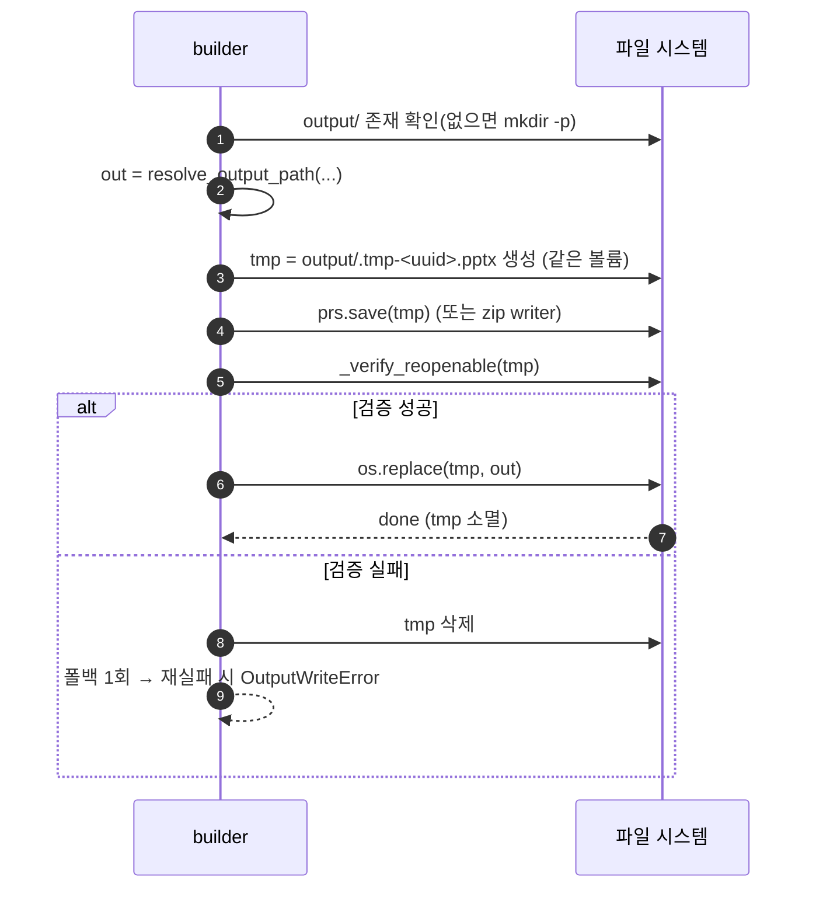

# 08. 배포·실행 아키텍처 (Deployment Architecture)

상위: `아키텍처.md` §4 / 계획서 02 §런타임, 05 §7, 07 §6 (참조). 이 문서는 실행 환경·파일 수명·자원 비용을 확정한다.

## 1. 실행 환경 (고정)

| 항목 | 값 | 확인 |
| --- | --- | --- |
| OS | Windows 10/11 (win32) | 실행 환경 |
| Python | 3.12.10 | `python --version` |
| 설치 | `python -m pip install -r requirements.txt` | `requirements.txt` = `python-pptx==1.0.2` |
| 전이 의존성 | `lxml`, `Pillow` (python-pptx 가 끌어옴) | 추가 설치 금지 |
| 표준 라이브러리 | `http.server`, `zipfile`, `copy`, `re`, `json`, `urllib`, `argparse`, `logging`, `unicodedata`, `uuid`, `threading` | 의존성 0 유지 |

**배포 형태**: 별도 배포 없음. 소스 트리를 그대로 두고 두 진입점을 실행한다.
패키징(exe/설치 프로그램)·컨테이너·서비스 등록은 채택하지 않는다 (계획서 01 비목표).

| 실행 | 명령 | 결과 |
| --- | --- | --- |
| 웹앱 | `python -m lyrics2pptx.webapp` | `http://127.0.0.1:8765`, Ctrl+C 종료 |
| CLI | `python -m lyrics2pptx.cli --query "생명샘" -o output/song.pptx` | 파일 생성, 종료코드 |
| 진단 | `python -m lyrics2pptx.cli --doctor` | 읽기 전용 리포트 |
| 테스트 | `python -m unittest discover -s tests -t .` | 네트워크 0회, 473 tests OK |

`python -m lyrics2pptx.X` 가 동작하려면 `src/` 가 import 경로에 있어야 한다. 두 가지 중 하나를 강제한다.

| 방식 | 설정 | 비고 |
| --- | --- | --- |
| A. `pyproject.toml` + `pip install -e .` (채택) | `[project] name="lyrics2pptx"`, `package-dir{"":"src"}` | `requirements.txt` 와 병행. T01 에 포함 |
| B. `PYTHONPATH=src` | 환경변수 | 설치 없이 가능. 문서에 병기 |

> `pip install -e .` 는 추가 의존성을 요구하지 않는다(빌드 백엔드는 `setuptools` 기본). 단, "의존성 0" 원칙을
> 흔들지 않기 위해 **B 도 항상 동작해야 한다**(테스트가 B 로 실행됨).

## 2. 환경 구분

| 환경 | 템플릿 | 네트워크 | fixture | 용도 |
| --- | --- | --- | --- | --- |
| dev (수동) | 실제 `template.pptx` | 허용 | 미설정 | 개발·수동 인수 |
| test (자동) | 실제 `template.pptx` | **차단** | `tests/fixtures` 설정 | 회귀 검증 |
| 사용자(배포) | 사용자 제공 | 수집 시만 | 미설정 | 실제 사용 |

환경 분기는 오직 `LYRICS2PPTX_*` env 로만 한다(`05 §5`). 코드에 `if DEBUG` 분기를 넣지 않는다.

## 3. 설정 파일

| 파일 | 역할 | 내용 |
| --- | --- | --- |
| `requirements.txt` | 런타임 의존성 핀 | `python-pptx==1.0.2` 한 줄 |
| `pyproject.toml` | 패키지 메타/설치 | `src` 레이아웃, `lyrics2pptx` 패키지 |
| `.gitignore` | 산출물 제외 | `output/*`, `*.pptx`(단 `!template.pptx`), `.tmp-*`, `__pycache__/`, `*.pyc`, `.ruff_cache/` |
| `README.md` | 실행/법적 고지 | 설치, 실행, 옵션, env, 가사 저작권 고지, 알려진 한계 |
| `계획서.md`, `아키텍처.md`, `docs/**` | 문서 | 계획/아키텍처 (산출물 아님) |

`template.pptx` 는 **리포지토리에 커밋한다**(약 37 MB). 근거(코드 기준):
`.gitignore` 는 `*.pptx` 를 무시하되 **`!template.pptx`** 로 템플릿만 되살리고, `tests/test_cli.py`
(doctor 의 `slide_count=20` 단언)·`tests/test_webapp.py`·빌드 테스트 일부는 템플릿 부재를
**스킵이 아니라 실패**로 처리한다. 따라서 템플릿을 빼면 CI/로컬 회귀가 즉시 깨진다.
`LYRICS2PPTX_TEMPLATE` 로 위치를 바꿀 수 있으므로 코드가 경로를 하드코딩하지는 않는다.

> 정정(이전 판): "커밋하지 않는 것을 기본 권고"라 적었으나, 실제 `.gitignore`(`!template.pptx`)와
> 템플릿을 필수로 요구하는 테스트 때문에 **커밋 유지가 코드 기준 정답**이다. CI 사전점검 단계가
> `template.pptx` 존재를 명시적으로 확인한다(`.github/workflows/ci.yml`).

## 4. 파일 수명과 원자적 쓰기 (AD-13)



| 항목 | 확정 |
| --- | --- |
| tmp 위치 | **최종 파일과 같은 디렉터리**(`output/`) — `os.replace` 는 같은 볼륨에서만 원자적 |
| tmp 이름 | `.tmp-<uuid4().hex>.pptx` (점 접두 → 눈에 덜 띄고 `.gitignore` 대상) |
| 이름 충돌 | uuid 로 회피. 덮어쓰기 사고 방지 |
| 실패 시 | `finally`/`except` 에서 `tmp.unlink(missing_ok=True)` — 반쪽 파일 잔존 금지 |
| 기존 파일 덮어쓰기 | 허용(사용자가 같은 이름 지정 시). 단 성공적으로 생성된 경우에만 교체 |
| 검증 후 교체 | `_verify_reopenable` 통과 후에만 교체 → 손상 파일이 최종 이름을 차지하지 못한다 |
| 동시성 | 빌드 전역 락(AD-14) + uuid → 같은 파일명 동시 쓰기 방지 |
| 정리 | 시작 시 `output/.tmp-*` 잔존 파일(이전 크래시) 1회 정리(선택, WARNING 로그) |

## 5. output 디렉터리 규칙

| 규칙 | 값 |
| --- | --- |
| 위치 | `config.OUTPUT_DIR` (기본 `<repo>/output`, `LYRICS2PPTX_OUTPUT_DIR` 로 변경) |
| 생성 | 없으면 자동 생성(`mkdir(parents=True, exist_ok=True)`) |
| `output_path` 지정 | 절대/상대 모두 허용. 상대는 `OUTPUT_DIR` 기준으로 해석 |
| 디렉터리 지정만 | `-o output/` 처럼 디렉터리면 `DEFAULT_FILENAME` 사용 |
| 이름 sanitize | `/ \ : * ? " < > |` 제거, 빈 이름 → `DEFAULT_FILENAME`, 길이 100자 제한 |
| 기존 파일 | 덮어쓰기 허용(원자적) |
| 정리 정책 | **자동 삭제 없음**(사용자 파일). 37MB/건 누적되므로 사용자가 관리. 용량 경고를 `--doctor` 에 표시 |
| 접근 제한 | 로컬 파일 시스템. 웹앱은 `output/` 를 정적 서빙하지 **않는다**(산출물은 다운로드 응답으로만 전달) |

## 6. 자원 비용 모델 (37MB 템플릿)

| 자원 | 추정 | 완화 |
| --- | --- | --- |
| 템플릿 열기 | 37MB zip 해제 + 파싱, 수백 ms~수 초 | 프로세스당 1회, `TemplateProfile` 캐시(size+mtime 키) |
| 복제 후 메모리 | 템플릿 + 복제 슬라이드 XML(수십 KB~수백 KB/장) | 슬라이드 XML은 작다. media 는 **재사용**(복사 없음) → 메모리 팽창 없음(AD-06) |
| 산출 파일 | ≈ 37MB + 슬라이드 delta | media 재사용으로 원본 대비 증가 최소 |
| 빌드 시간 | 템플릿 열기 + 저장 I/O 지배 | 동시 빌드 0(AD-14) 으로 CPU/디스크 경합 제거 |
| 디스크 누적 | 37MB × 생성 건수 | 사용자 관리(§5). `--doctor` 에 `output/` 총 용량 표시 |
| 웹서버 메모리 | 37MB + 요청 버퍼(≤1MiB) | 요청 상한, 빌드 락 |

**설계 결론**: 이 비용 때문에 (a) 템플릿은 **프로세스당 1회만 연다**, (b) 빌드는 **직렬화**한다,
(c) media 는 **절대 복제하지 않는다**. 이 세 가지가 37MB 를 감당하는 아키텍처의 전부다.

## 7. 테스트 실행 (T11)

```bat
:: src 레이아웃 수동 경로 (설치 없이)
set PYTHONPATH=src
set LYRICS2PPTX_FIXTURE_DIR=tests\fixtures
python -m unittest discover -s tests -t .

:: 네트워크 실호출 차단 상태로도 통과해야 한다 → 현재 473 tests OK
```

| 원칙 | 강제 |
| --- | --- |
| 네트워크 0회 | `test_httputil.py` 가 소켓을 모킹하고, fixture 모드에서 실 요청 0을 단언 |
| 실물 템플릿 사용 | `test_clone.py`/`test_fill.py`/`test_builder.py`/`test_template_reader.py`/`test_writer_contract.py` 는 없으면 `skipUnless` 로 건너뛴다. 반면 **`test_cli.py`(doctor slide_count=20)·`test_webapp.py`·빌드 성공 테스트는 skip 가드가 없어 템플릿 부재 시 실패**한다 → CI 가 템플릿 존재를 사전점검한다. |
| 결정성 | 시간 의존 테스트는 `monotonic`/`sleep` 을 패치 |
| 격리 | 각 테스트가 자기 tmp 출력 디렉터리 사용(`tempfile.TemporaryDirectory`) |

## 8. 운영 절차 (사용자 관점)

| 단계 | 명령/동작 |
| --- | --- |
| 1 설치 | `python -m pip install -r requirements.txt` |
| 2 자산 확인 | `python -m lyrics2pptx.cli --doctor` (템플릿 슬라이드 20장, 스타일 확인) |
| 3 실행(웹) | `python -m lyrics2pptx.webapp` → 브라우저 → 검색/직접입력 → 생성 → 다운로드 |
| 4 실행(CLI) | `python -m lyrics2pptx.cli --query "..." -o output/song.pptx` |
| 5 검증 | PowerPoint 로 열기 → 2줄/배경 순환/노트 빈 상태 확인 (07 §5 체크리스트) |
| 6 문제 시 | `--doctor`, `--strategy zip`(폴백 강제), `LYRICS2PPTX_LOG_LEVEL=DEBUG` |

## 9. 롤백/복구

| 상황 | 대응 |
| --- | --- |
| 산출물 손상 | 성공 시에만 교체하므로 이전 파일 보존. 손상 tmp 는 자동 삭제 |
| 방식 A 회귀 | `--strategy zip` 로 즉시 우회(동일 계약) |
| 템플릿 교체 | `LYRICS2PPTX_TEMPLATE` 로 다른 파일 지정. 도형명 다르면 `LYRICS2PPTX_TITLE_SHAPE` |
| 소스 차단 | 직접 입력 경로 사용(네트워크 불필요) |
| 템플릿 실수 수정 | 리포지토리 사본/백업에서 복원. 코드는 절대 쓰지 않으므로 손상원이 되지 않음 |
