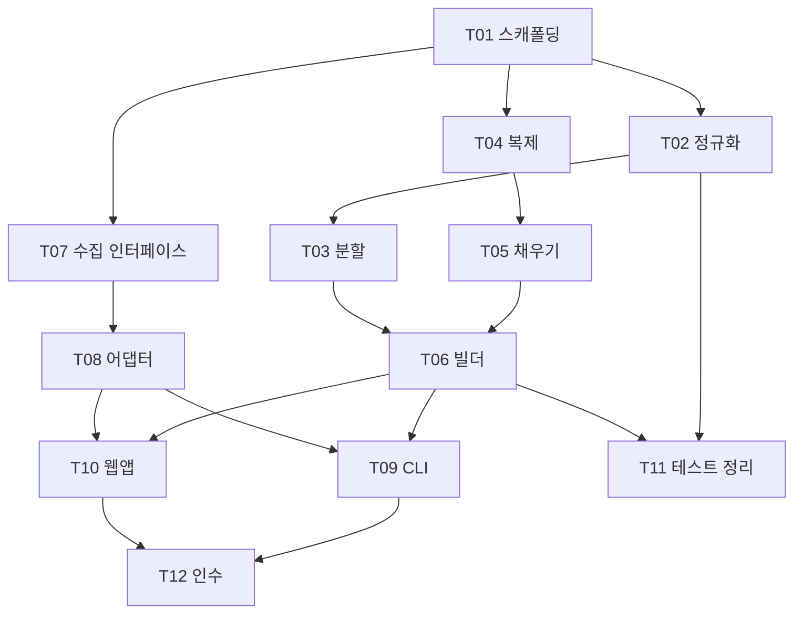

# 10. 태스크 ↔ 모듈 매핑 (Task Mapping for Coder)

상위: `아키텍처.md` §7 / 로드맵 원본: `계획서.md` §로드맵, `docs/plan/08` (참조).
이 표가 **다음 단계(Coder)의 작업 큐**다. 각 태스크는 "어느 파일을 만들고, 무엇이 만족되면 끝인가"를 명시한다.

## 1. 매핑 표 (T01~T12)

| Task | 제목 | 생성/수정 파일 (모듈) | 아키텍처 근거 | 완료 판정 (테스트/명령) |
| --- | --- | --- | --- | --- |
| **T01** | 스캐폴딩 + 의존성 + fixture 로더 | `requirements.txt`, `pyproject.toml`, `.gitignore`, `src/lyrics2pptx/__init__.py`, `errors.py`, `config.py`, `crawl/__init__.py`(빈 레지스트리), `crawl/httputil.py`(골격+fixture 훅), `tests/__init__.py`, `tests/test_imports.py` | `07 §6`, AD-03, AD-16, `08 §1` | `pip install -r requirements.txt` 후 `python -c "import pptx, lyrics2pptx"` 성공, `test_imports.py` 통과(P1~P9) |
| **T02** | 텍스트 정규화 | `src/lyrics2pptx/text/__init__.py`, `text/normalize.py`, `tests/fixtures/lyrics_sample.txt`, `tests/test_normalize.py` | `03 §1` E3, 계획 D3 | `test_normalize.py` 통과: CRLF/3+개행/다중공백/NBSP/마커/줄끝`|`, 골든 4줄, NFC |
| **T03** | 2줄 분할 | `text/split.py`, `tests/test_split.py` | `03 §1` E4, `03 §2 LinePair`, AD-10 인접 | 4줄→2페어, 5줄→3페어(마지막 `(x,None)`), 1줄→1페어, 0줄→`[]`, `dedupe_repeat` 차이 |
| **T04** | 슬라이드 복제 엔진 | `pptx/__init__.py`, `pptx/template_reader.py`, `pptx/clone.py`, `pptx/writer_parts.py`, `tests/test_clone.py`, `tests/test_template_reader.py` | **`04 §3`, AD-04, AD-06, AD-11, AD-12** | 복제 N장에서 image rel 존재·대상=원본 media, `ppt/media/*` 개수 불변, slide20 `<p:pic r:embed>` 유효, `sldIdLst` 길이=N, 원본 20장 부재, notesSlide rel 부재 |
| **T05** | `제목 1` 채우기 + autofit | `pptx/fill.py`, `tests/test_fill.py` | **`04 §4`, AD-07, AD-11** | 텍스트 == `[l1,l2]`(홀수 `[l1]`), `sz`==소스 첫 run, `normAutofit` 존재, `a:off/a:ext` 불변 |
| **T06** | pptx 빌더 (배경 순환 + 조립) | `pptx/builder.py`, `pptx/writer_zip.py`(폴백), `pptx/writer.py`(`PptxWriter` 선택), `tests/test_builder.py`, `tests/test_writer_contract.py` | **`04 §2, §5–§7`, AD-10, AD-13** | 25줄→13장, 40줄→20장, 42줄→21장(bg[20]=0), `Presentation()` 재열기 성공, `EmptyLyricsError`, 방식 A vs F1 동등성 |
| **T07** | 수집 인터페이스 + HTTP 예절 | `crawl/base.py`, `crawl/httputil.py`(완성), `tests/test_httputil.py` | `06 §2`(robots/UA/지연/백오프), AD-05 | fixture 모드 `fetch` 성공, robots Disallow→`SourceBlockedError`, 429×3→`SourceUnavailableError`, UA 헤더 포함, 지연 ≥ delay, 소켓 실호출 0 |
| **T08** | 참조 어댑터 1종 | `crawl/lyrics_ovh.py`, `crawl/__init__.py`(`SOURCES`+`get_source`), `crawl/html_generic.py`(비활성 스켈레톤), `tests/fixtures/lyrics_ovh_sample.json`, `tests/fixtures/not_found.json`, `tests/test_crawl.py` | `06 §1`(합법 소스만 기본), AD-05 | fixture 로 `RawSong(title,artist,lyrics)` 반환, 3종 예외 타입 정확, 실 검색어 1건 획득(수동) |
| **T09** | CLI | `cli.py`(`--doctor` 포함), `tests/test_cli.py` | `05 §3`, `07 §7` | `--query`/`--input-file` 파일 생성, `--json` 유효 JSON(stdout 오염 없음), 종료코드 표 준수, `--doctor` 동작 |
| **T10** | 로컬 웹앱 | `webapp.py`, `web/index.html`, `web/app.js`, `web/style.css`, `tests/test_webapp.py` | `05 §2`, AD-14, AD-15 | 127.0.0.1:8765 접속, 검색→선택→생성→다운로드(수동), 오류 404/423/502/422 규약, `/static` 탈출 404, 요청 상한 413 |
| **T11** | 테스트 스위트 정리 | `tests/test_preview.py`, `tests/test_pipeline_errors.py`, 기존 테스트 정비 | `03 §4`, `07 §2`, `08 §7` | `python -m unittest discover -s tests -v` 전체 통과, 네트워크 0회, fixture 모드 병행 통과 |
| **T12** | 수동 인수 검증 | `docs/` 기록(체크리스트 결과), `output/` 보존 | `08 §8`, 계획 07 §5 | PowerPoint 육안 체크리스트 전 항목, 실패 시 재현 명령 기록 |

## 2. 구현 순서와 의존 (계획서 08 §1–2 승계 + 병렬 구간)



**병렬 실행 가능 구간** (T01 이후): `{T02,T03}` / `{T04,T05}` / `{T07,T08}` 세 갈래는 서로 독립.
**합류**: T06(빌더)과 T08(어댑터)이 끝나야 T09/T10 착수 가능.

> **리스크 우선 원칙(계획서 08 §2)**: T04 를 스캐폴딩 직후 배치해 최대 리스크(R1: 파트 등록 불가)를 먼저 털어낸다.
> T04 실패 시 폴백 F1(`04 §6`)까지 일정에 포함해야 한다.

## 3. 모듈별 파일 체크리스트 (생성 대상)

```
src/lyrics2pptx/
  __init__.py            T01   버전, 공개 API 재노출
  errors.py              T01   Lyrics2PptxError 계층 (AD-03)
  config.py              T01   상수/경로/env 단일 출처
  pipeline.py            T11   run()/search_hits()/describe_error()/resolve_output_path()
  cli.py                 T09
  webapp.py              T10
  crawl/
    __init__.py          T01/T08  SOURCES + get_source
    base.py              T07      RawSong, Source, SourceError 계층
    httputil.py          T01/T07  robots/UA/지연/백오프/fixture 훅
    lyrics_ovh.py        T08
    html_generic.py      T08      비활성 스켈레톤
  text/
    __init__.py          T02
    normalize.py         T02
    split.py             T03
  pptx/
    __init__.py          T04
    template_reader.py   T04      TemplateProfile, StyleSpec, 캐시
    clone.py             T04      방식 A + remap_relationships
    fill.py              T05      find_title1 + txBody 재구성
    writer.py            T06      PptxWriter 프로토콜 + strategy 선택
    writer_parts.py      T04      방식 A writer
    writer_zip.py        T06      폴백 F1 writer
    builder.py           T06      배경 순환 + 조립 + 원자적 저장
web/
  index.html             T10
  app.js                 T10
  style.css              T10
tests/
  __init__.py            T01
  test_imports.py        T01      P1~P9 강제
  test_config.py          T01
  test_errors.py          T01
  test_normalize.py      T02
  test_split.py          T03
  test_clone.py          T04
  test_template_reader.py T04
  test_fill.py           T05
  test_builder.py        T06
  test_writer_contract.py T06     방식 A / 폴백 F1 계약 동등성
  test_httputil.py       T07
  test_crawl.py          T08      레지스트리 + 어댑터
  test_cli.py            T09
  test_cli_encoding.py   T09      cp949 콘솔 인코딩
  test_webapp.py         T10
  test_preview.py        T10      /api/preview (M1)
  test_pipeline_errors.py T11
  fixtures/
    lyrics_sample.txt    T02
    lyrics_ovh_sample.json T08
    not_found.json       T08
output/                  (런타임 생성, .gitignore)
```

## 4. Coder 를 위한 구현 규칙 요약 (문서 참조)

| 규칙 | 출처 |
| --- | --- |
| 계층 화살표만 허용, 순환 금지 | `02 §3–4` |
| 경계 타입(dataclass) 필드명 고정 | `03 §2` |
| 예외는 `errors.py`+`crawl/base.py` 만 | `03 §3` |
| 오류 문구 변환은 `describe_error()` 하나 | `03 §4` |
| 복제 방식 A + rels 재매핑 + media 재사용 | `04 §3` |
| 폴백 F1 동일 계약 | `04 §6` |
| 배경 순환 수식 `pool[k % P]` | `04 §2.1` |
| 채우기 F1~F8 규칙 | `04 §4.2` |
| 원자적 쓰기 tmp→replace | `08 §4` |
| robots/UA/지연은 httputil 에서만 | `06 §2` |
| 로깅 포맷/수준, 가사 본문 금지 | `07 §1–2` |
| env 접근은 config.py 만 | `05 §5`, P9 |
| UTF-8 no BOM / LF | `08 §1`, 계획서 02 |

## 5. 각 태스크의 "끝" 정의 (아키텍처 관점 게이트)

| 게이트 | 통과 조건 |
| --- | --- |
| G-STRUCT | `test_imports.py` 통과 (의존 방향·순환·env 접근) |
| G-CLONE | 복제 후 media 개수 불변 + 재열기 성공 (`04 §9`) |
| G-CYCLE | 25/40/42줄 배경 순서 단언 (`04 §2.3`) |
| G-FILL | 텍스트/서식/위치/autofit 단언 (`04 §4.4`) |
| G-ERROR | `describe_error` 가 7종 예외 모두 커버 (`03 §4`) |
| G-NET | 네트워크 실호출 0 (fixture 모드 + 소켓 모킹) |
| G-BOUND | localhost 바인딩, 요청 상한, static containment |
| G-ACCEPT | PowerPoint 육안 체크리스트 (`08 §8`) |
