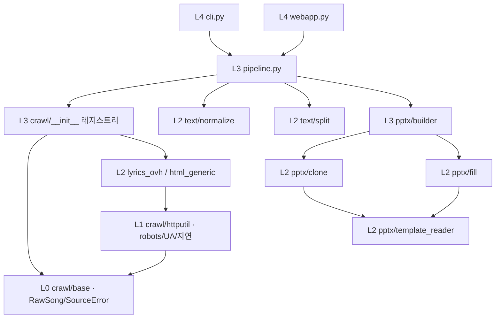

# 아키텍처 — 가사 2줄 PPTX 생성기 (lyrics-2line-pptx)

> **인덱스 전용.** 요구·범위·이유의 원문은 `계획서.md` 와 `docs/plan/01~08` 에 있다 (복제하지 않고 참조).
> 이 문서와 `docs/arch/*` 는 "그 요구를 어떤 구조로 구현하는가"만 확정한다.

## 1. 아키텍처 스타일

**선정: 모듈러 모놀리스(modular monolith)** — 단일 프로세스, 계층형, in-process 함수 호출.

| 항목 | 확정 |
| --- | --- |
| 프로세스 | CLI 1개 + 로컬 웹서버 1개 (동일 소스 트리) |
| 네트워크 경계 | **수집 단계 하나뿐.** 애플리케이션 내부 호출은 전부 함수 호출 |
| 계층 | L0 leaf(`errors`, `config`) → L1 `crawl/httputil` → L2 도메인(`text/*`, `pptx/*`, `crawl/<site>`) → L3 조립(`pipeline`, `pptx/builder`, `crawl/__init__`) → L4 진입점(`cli`, `webapp`) |
| 상태 | 무상태. 영속 대상은 `output/*.pptx` 파일뿐 |
| 인증 | 없음 (localhost 단일 사용자) |

근거: 요구가 "검색어 1개 → pptx 1개", 동시 사용자 1명이다. 계층 분리는 `text`/`pptx`/`crawl` 축을
서로 모르게 하기 위한 것이고, 그 이상의 런타임 분할은 비용만 늘린다.

### 채택하지 않은 것 (한 줄 이유)

| 미채택 | 이유 (한 줄) |
| --- | --- |
| 마이크로서비스 | 프로세스 1개·동시 사용자 1명이라 분할 이득이 직렬화/운영 비용보다 작다 |
| 메시지 큐 / 워커 | 요청 1건당 수 초, 동시 요청이 없어 큐가 흡수할 대상이 없다 |
| 이벤트 버스 / pub-sub | 발행자와 구독자가 항상 같은 호출 스택 안에 있다 |
| RDBMS / ORM | 영속 대상이 산출 pptx 파일 하나뿐이라 파일 시스템이 곧 저장소다 |
| 캐시 서버(Redis 등) | 검색어 캐시는 dict 1개의 프로세스 메모리로 충분하다 |
| DI 컨테이너 | 모듈이 10여 개, 생성 인자가 0~2개다 |
| 웹/프론트 프레임워크 | 라우트 3개 + 정적 1페이지 (계획서 02, 06) |
| 분산 트레이싱 / 메트릭 수집기 | 호출이 전부 in-process 이고 관측 대상이 프로세스 1개다 |
| Docker / 클라우드 배포 | 로컬 실행이 요구사항이다 (계획서 01 비목표) |

## 2. 컴포넌트 다이어그램

> 모든 계층은 L0 `errors.py` 를, 경로/설정이 필요한 모듈은 `config.py` 를 추가로 import 한다 (도해 생략).
> **금지 의존(강제)**: `text/*→pptx|crawl`, `pptx/*→crawl`, `crawl/*→text|pptx`, 하위→`builder`, 임의→`cli|webapp`, 순환.
> `pipeline.py` 만이 세 축을 조립하는 유일한 모듈이다. 검증은 `test_imports.py`. 상세: `docs/arch/02`.

## 3. 기술 스택 (근거는 계획서 02)

| 레이어 | 선택 | 아키텍처상 역할 |
| --- | --- | --- |
| 런타임 | Python 3.12.10 (win32) | 단일 프로세스, 표준 `logging`/`http.server` |
| pptx 생성 | `python-pptx==1.0.2` + `copy.deepcopy` + OPC rels 제어 | `pptx/` 4개 모듈의 유일한 외부 의존 |
| 복제 전략 | **방식 A**: `<p:sld>` deepcopy → 신규 파트 등록 → rels 재매핑 | `pptx/clone.py` 핵심 + 폴백 F1 |
| 수집 | 표준 `urllib.request` | 예절/백오프/fixture 훅을 `httputil` 에 집중 |
| 웹 UI | 표준 `http.server` + vanilla HTML/JS | `webapp` 은 `pipeline.run()` 만 호출 |
| 테스트 | 표준 `unittest` + 오프라인 fixture | 경계마다 골든 테스트 1개 |

## 4. 횡단 관심사 요약

| 관심사 | 확정 위치 | 요약 |
| --- | --- | --- |
| 예외 계층 | `errors.py` + `crawl/base.py` | `Lyrics2PptxError` ← `SourceError`,`EmptyLyricsError`,`TemplateStructureError`,`OutputWriteError`,`ConfigError` |
| 오류→사용자 메시지 | **`pipeline.describe_error()` 단 한 곳** | CLI/웹 동일 표. 스택트레이스 비노출 |
| 설정 | **`config.py` 만 `os.environ` 접근** | `LYRICS2PPTX_*` 18종 (`docs/arch/05 §5`) |
| 로깅 | `logging` 루트 `lyrics2pptx` | 기본 INFO, `%(asctime)s %(levelname)s %(name)s %(message)s` |
| 원자적 쓰기 | `output/.tmp-<uuid>.pptx` → `os.replace` | 같은 볼륨, 검증 후 교체, 실패 시 정리 |
| 인코딩/개행 | UTF-8 no BOM / LF | 소스·문서·json·html 전부 |
| 법적 강제 | `crawl/httputil.py` (전송 계층) | robots/UA/지연을 어댑터가 우회 불가 |
| 보안 경계 | `webapp.py` | 127.0.0.1 바인딩, `/static` 탈출 차단, 1 MiB 상한 |
| 빌드 동시성 | `webapp.py` 전역 락 | 빌드 직렬화 (동시성 0) |
| 템플릿 무결성 | `pptx/template_reader.py` | `template.pptx` 읽기 전용, 항상 새 파일 산출 |

## 5. 문서 인덱스

| 파일 | 목적 | 줄 수 |
| --- | --- | --- |
| `docs/arch/01-system-context.md` | 시스템 경계, 액터, 런타임 토폴로지, 실패 격리 | 112 |
| `docs/arch/02-component-architecture.md` | 모듈 책임, 허용 의존 화살표, 금지 규칙, 컴포넌트·시퀀스 다이어그램 | 191 |
| `docs/arch/03-data-architecture.md` | dataclass 계약, 경계별 타입, 예외 트리, 오류 매핑 단일 지점 | 226 |
| `docs/arch/04-pptx-generation-algorithm.md` | 복제 방식 A 의사코드, rels 재매핑, media 재사용, sldIdLst, 폴백 F1, 채우기 F1~F8, 배경 순환 | 400 |
| `docs/arch/05-interface-contracts.md` | HTTP/CLI/파이프라인 계약, 오류 코드, env 전체 목록, 파일 계약 | 188 |
| `docs/arch/06-security-and-legal-architecture.md` | robots/UA/지연 강제 계층, 신뢰 경계, 라이선스 고지 위치 | 140 |
| `docs/arch/07-observability-and-config.md` | 로깅 정책·이벤트 표, 상관관계, config 단일 출처, 진단 명령 | 147 |
| `docs/arch/08-deployment-architecture.md` | 실행 환경, 원자적 쓰기, output 규칙, 37MB 비용 모델, 테스트 실행 | 154 |
| `docs/arch/09-decision-log.md` | AD-01~AD-16 (아키텍처 결정), D1~D11 매핑, 미해결 Q | 162 |
| `docs/arch/10-task-mapping.md` | T01~T12 ↔ 모듈/파일, 의존 순서, 완료 게이트 | 137 |

## 6. 읽는 순서

- 구조 파악: **01 → 02 → 03**
- **pptx 복제 구현(최우선)**: 04 → 03(타입) → 02(의존) → 09(AD-04/06/07/10/11/12)
- 수집·법적 경계: 06 → 05(계약)
- 진입점: 05 → 07 → 08
- 작업 배분: **10 (Coder 의 작업 큐)**

## 7. 태스크 ↔ 모듈 매핑 (요약, 상세는 10)

| Task | 주 모듈 | Task | 주 모듈 |
| --- | --- | --- | --- |
| T01 | `errors`, `config`, `crawl/httputil`(골격), `test_imports` | T07 | `crawl/base`, `crawl/httputil`, `test_httputil` |
| T02 | `text/normalize` | T08 | `crawl/lyrics_ovh`, `crawl/__init__`, `html_generic` |
| T03 | `text/split` | T09 | `cli` (CLI + `--doctor`) |
| T04 | `pptx/template_reader`, `clone`, `writer_parts` | T10 | `webapp`, `web/*` |
| T05 | `pptx/fill` | T11 | `tests/*` 정비, `pipeline` |
| T06 | `pptx/builder`, `writer`, `writer_zip` | T12 | 수동 인수 체크리스트 |

병렬 구간(T01 이후): `{T02,T03}` / `{T04,T05}` / `{T07,T08}`. 합류: T06·T08 완료 후 T09/T10.
**T04 를 스캐폴딩 직후 실행**해 최대 리스크(파트 등록)를 먼저 제거한다. 전체 매핑·게이트: `docs/arch/10`.
